# Capstone Project: Secure Public Cloud Services

Georgy Bodrov

## Architecture diagram

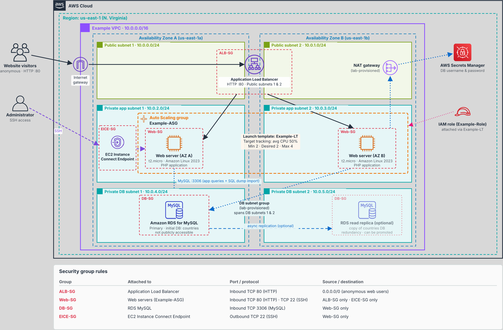

## Overview

The aim of this project was to move the provisioned Example Social Research Organisation website off a single public EC2 instance, where the PHP site and MySQL database shared one server, onto a secure highly available and scalable design. In my build, the website runs on t2.micro web servers in private subnets behind an Application Load Balancer, the data lives in a separate Amazon RDS MySQL database, and the database credentials are stored in AWS Secrets Manager. This was done as part of the AWS Academy Cloud Architecting [185410] course within a lab environment with a $60 budget.

## Setup

Before starting anything on the brief, I added budget alerts for the lab session to alert me if I accidentally start spending too much. I set up a monthly cost budget of $60 that emails me when actual spend reaches 85% and 100% or when forecast spend is expected to go over 100%. Since the lab environment was persistent, this was a measure to ensure that I don’t go over budget before being able to complete it.

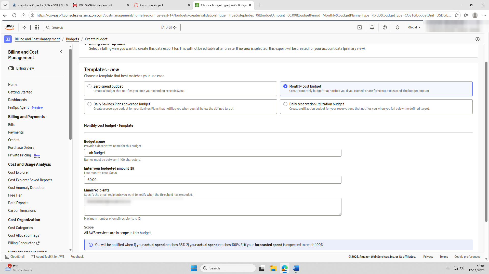

## Creating Amazon RDS MySQL database

I created a RDS MySQL database and assigned the following specs:

| Setting                     | Value                                                                                                                           |
|-----------------------------|---------------------------------------------------------------------------------------------------------------------------------|
| Engine Type                 | MySQL                                                                                                                           |
| Templates                   | Free tier Deployment (*The diagram plans for two, a primary and a read replica but the lab environment blocks from doing that*) |
| Engine Version              | MySQL 8.4.11                                                                                                                    |
| Credential management       | AWS Secrets Manager                                                                                                             |
| Instance Type               | db.t4g.micro                                                                                                                    |
| Storage Type and Allocation | GP SSD (gp2), 20 GB                                                                                                             |
| VPC                         | Project VPC                                                                                                                     |
| AZ                          | us-east-1a                                                                                                                      |
| Subnets                     | Private DB subnet 1                                                                                                             |
| Rules                       | Port 3306 only accessible to webserver Role                                                                                     |

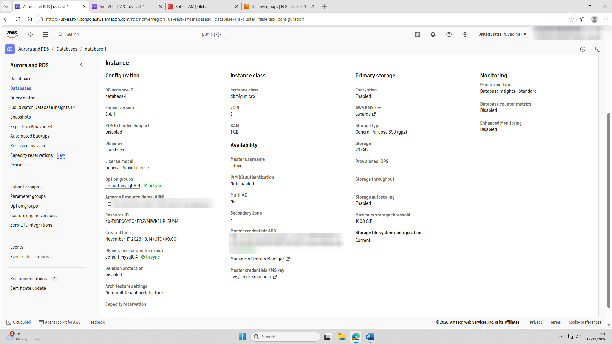

## Creating an Application Load Balancer

When creating the Load balancer, I gave it the following configurations:

| Setting | Value |
|---------|------------------------------------------------|
| Type    | Application Load Balancer                      |
| Scheme  | Internet facing                                |
| VPC     | Project-VPC                                    |
| AZs     | us-east-1a, us-east-1b                         |
| Subnets | Public subnet 1 and 2                          |
| Rules   | Port 80 is forwarded to webserver target group |

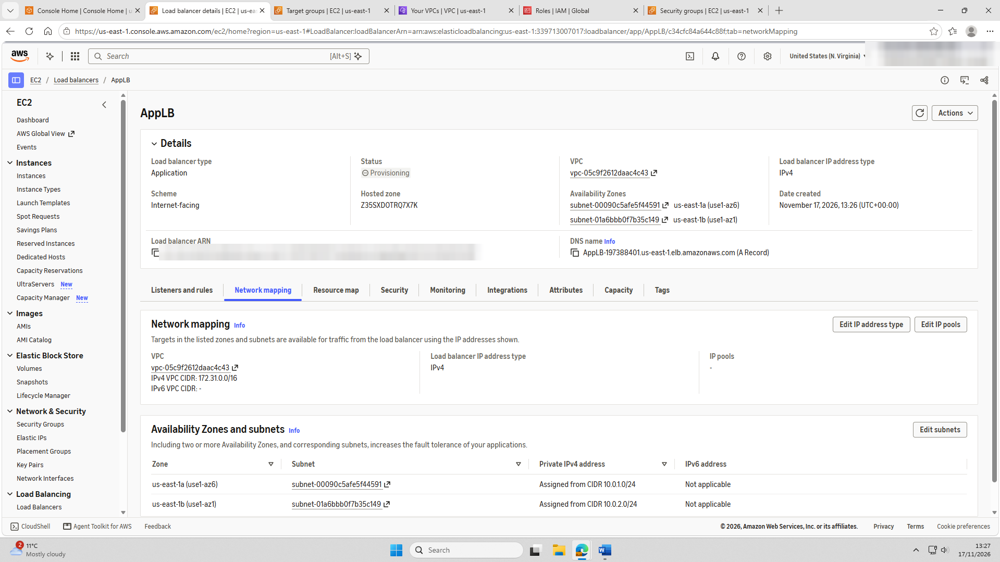

As for the target group, when it was first made it had no targets because the application hasn’t been created yet. Later, the Auto Scaling Group registered the web servers with this target group automatically as they launched, so I never had to add instances by hand.

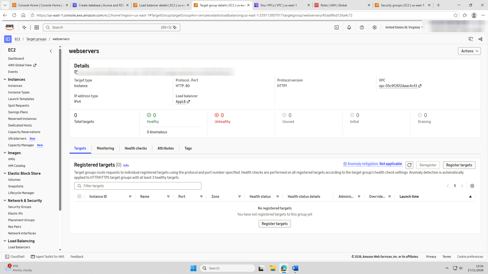

## Creating the Application server

The lab came with a pre-made launch template called Example-LT. It comes pre-built with the PHP application and a SQL dump file. To actually start some instances, I created an auto-scaler group.

I named the Auto Scaling group App-Scaler and gave it a desired capacity of 2, with a minimum of 2 and a maximum of 4 instances, spread across Private Subnet 1 (us-east-1a) and Private Subnet 2 (us-east-1b). I added a target tracking policy that keeps average CPU utilisation at 60%, with a 300 second warm-up so new instances are not counted until they have started properly. A minimum of two keeps one web server in each availability zone, and a maximum of four caps the cost if traffic spikes.

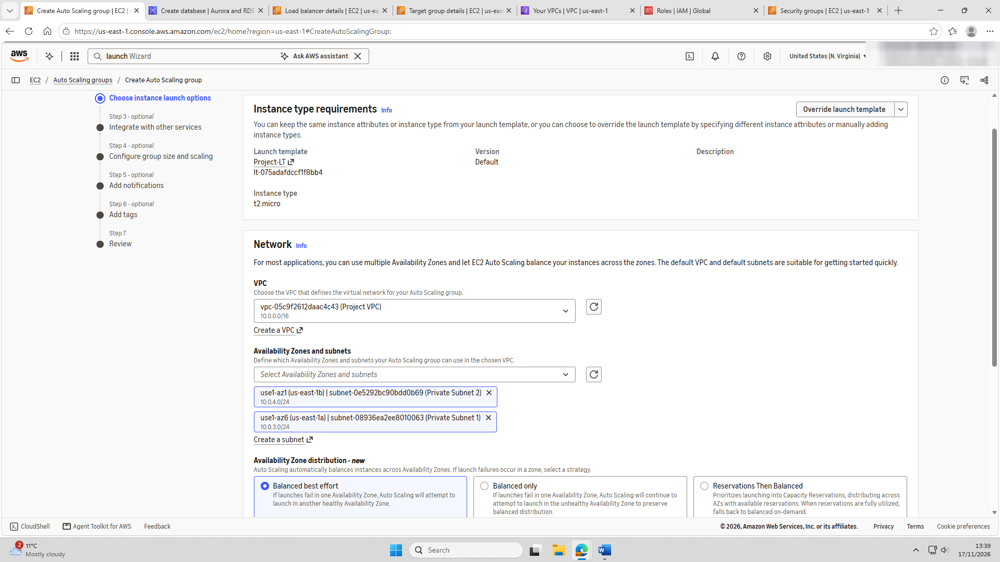

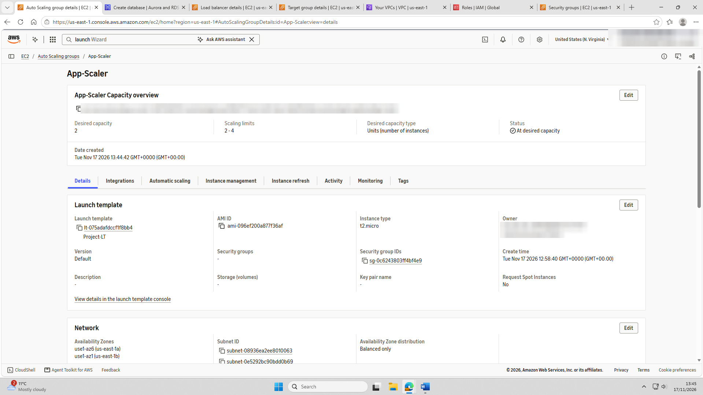

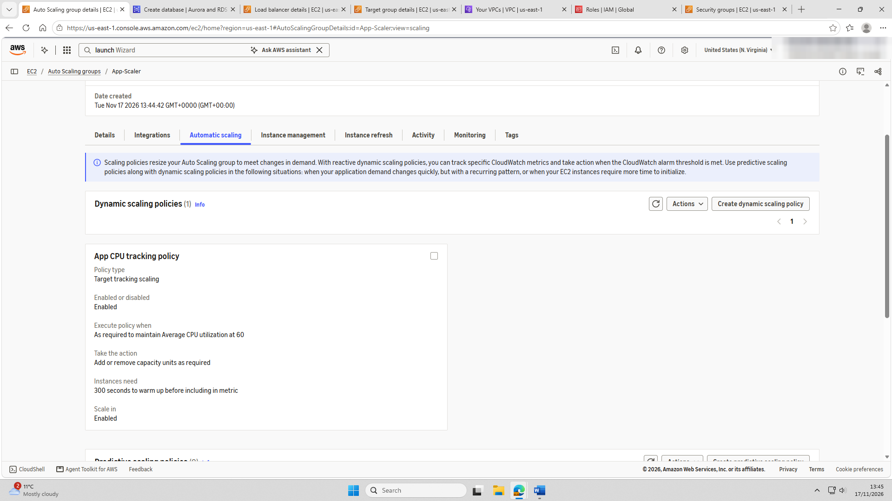

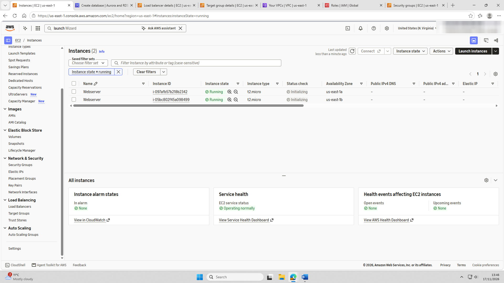

## Importing data into an RDS MySQL database

To add the data to my RDS MySQL database I had to access it through an EC2 instance’s shell. To do that I went into one of my running webservers through SSM Session Manager. I used Session Manager because it needs no inbound ports open on the web servers and no key pairs to manage, and every session is authenticated through IAM.

After that I logged into ec2-user with:

```bash
sudo su - ec2-user
```

Once I was in, I used wget to download the sqldump from the AWS details in the lab specification:

```bash
wget https://aws-tc-largeobjects.s3.us-west-2.amazonaws.com/CUR-TF-200-ACACAD-3-113230/22-lab-Capstone-project/s3/Countrydatadump.sql
```

Then I logged into the RDS database through its endpoint using the master user defined earlier and a password generated through AWS Secrets manager.

```bash
mysql -u admin -p -h database-1.cbcaa6w6svp6.us-east-1.rds.amazonaws.com countries
```

Finally, once I had the sqldump, I ran this command and the queries ran OK:

```sql
source Countrydatadump.sql
```

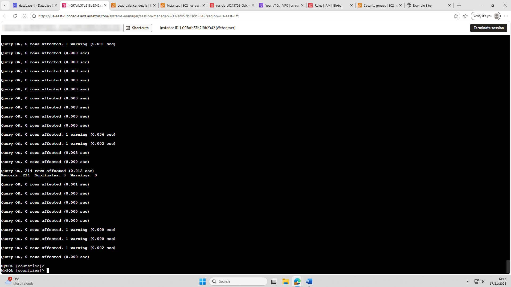

## Testing the application and reviewing imported data

I tested the application by going to the load balancer DNS name and then trying to query the database through the site. The home page loaded through the load balancer, which shows requests were reaching the web servers. On the query page I ran the “population” query and it returned a table of countries with their population and urban population, confirming the application could get its credentials and read from the RDS database.

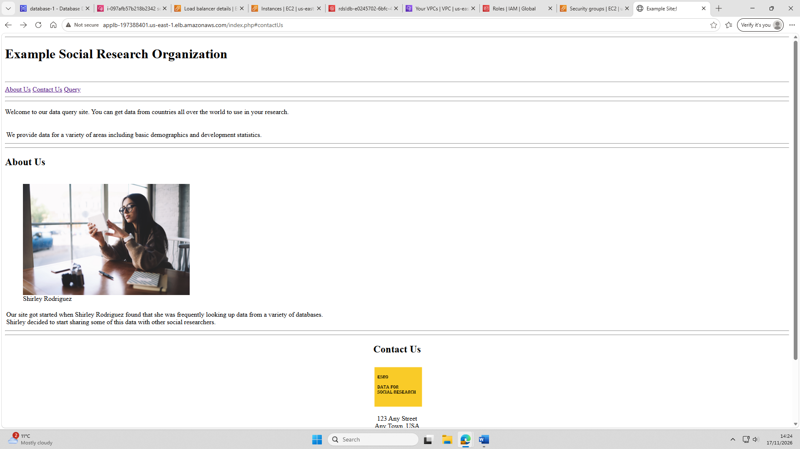

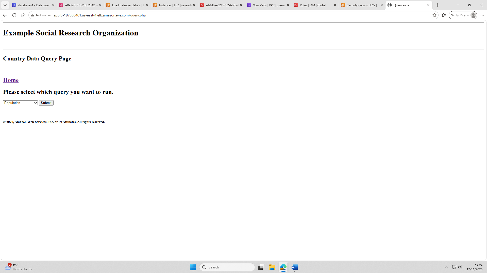

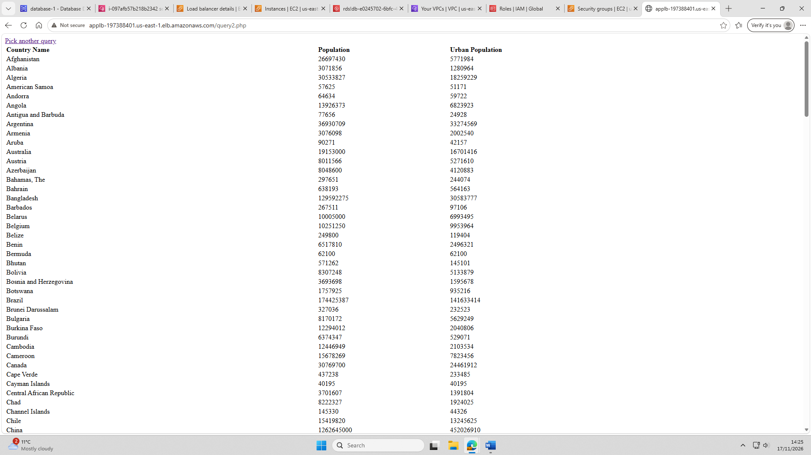

## Design Decisions

**Security.** Only the load balancer can be reached from the internet. The web servers and the database sit in private subnets with no public IP addresses, and each tier has its own security group, so traffic can only flow from the load balancer to the web servers and from the web servers to the database. This matters given the ransomware attempt described in the brief.

**Availability and scaling.** The load balancer and the Auto Scaling group both span two Availability Zones. If a server or a whole zone fails, the load balancer stops sending it traffic and the Auto Scaling group launches a replacement. Scaling on CPU adds servers as traffic grows, which addresses the slow response complaints.

**Cost.** The brief allows the database to run in a single Availability Zone, so with a limited lab budget and lab IAM restrictions, I chose single-AZ, and I used the smallest instance sizes that run the application.

## Changes from proposed diagram

The read replica in my diagram was optional, and the lab environment blocked creating it, so the database runs as a single instance. I also used Session Manager for administrator access instead of the EC2 Instance Connect Endpoint shown in the diagram, since it still gives administrators secure shell access without opening any ports.

## Result

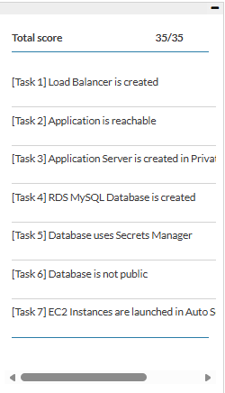

After finishing the build, I submitted the lab and scored 35 out of 35, passing all seven auto-graded tasks.

## Conclusion

The finished solution meets the requirements in the brief: the database is hosted securely in RDS with its credentials in Secrets Manager, the website is publicly reachable through a load balancer, and the web servers run in private subnets inside an Auto Scaling group across two Availability Zones. For a real production site, the next steps would be HTTPS, a Multi-AZ database and user authentication.
